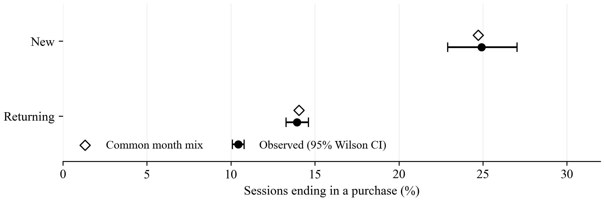

# Purchase Conversion by Visitor Type

Does month composition explain the difference in purchase rates between new and returning visitors?

This analysis uses the [UCI Online Shoppers Purchasing Intention Dataset](https://doi.org/10.24432/C5F88Q). It validates the required fields, retains the New and Returning visitor groups, computes purchase rates and 95% Wilson intervals, and gives both groups the same pooled monthly distribution as a descriptive sensitivity check.

## Results

| Visitor type | Sessions | Purchases | Observed rate | 95% Wilson interval | Common month mix |
|---|---:|---:|---:|---:|---:|
| New | 1,694 | 422 | 24.91% | 22.91%-27.03% | 24.72% |
| Returning | 10,551 | 1,470 | 13.93% | 13.28%-14.61% | 14.06% |

The observed difference is 10.98 percentage points; standardizing the month mix leaves a 10.67-point difference. Month composition alone does not account for the gap in this sample. This is not a causal estimate. Visitor characteristics may differ, and February contains only one New visitor. No confidence interval is calculated for the standardized rates.



[Markdown source](Yunya_Lin_UChicago_Coding_Essay.md) · [Two-page PDF](Yunya_Lin_UChicago_Coding_Essay.pdf) · [Earlier Word version](Yunya_Lin_UChicago_Coding_Essay.docx) · [Exact console output](support/results/console_output.txt) · [Execution record](support/results/execution_record.txt)

## Reproduce

The analysis was executed locally on macOS with Python 3.13.5. Package versions are pinned in `requirements.txt`.

```sh
python3 -m venv .venv
source .venv/bin/activate
python -m pip install -r requirements.txt
python coding_essay.py
```

The CSV is included, so the analysis needs no network access. The script prints the results and writes the figure to `support/results/conversion_comparison.png`. It uses Times New Roman when available and falls back to DejaVu Serif for the figure. There is no random sampling in the analysis.

The current PDF is exported from the editable Markdown source. To export it using Node.js 24 or later:

```sh
npm install
npm run export:pdf
```

The exporter parses Markdown into HTML and prints it to PDF using a fresh headless browser. It uses an installed Playwright Chromium binary if available, otherwise installed Google Chrome. If neither is available, run `npx playwright install chromium` first. Times New Roman and Courier New should be installed to match the checked layout. The code is grouped into three fenced blocks, followed by captured Python output, the original Matplotlib figure, and interpretation. An explicit page break keeps the document at two pages; inspect the exported PDF after substantive edits.

Python code is syntax-highlighted with PrismJS using restrained notebook-style colors on light-gray cells. Keywords are green, strings red, and operators purple; prose, captured output and the analytical figure remain monochrome. The exporter verifies that highlighting preserves the exact code and output text.

The Python script and data are unchanged. The PDF uses the current Markdown wording, including removal of the standalone author line. The earlier Word document and its builder are retained as the previous editable layout. `support/build_pdf.py` is also retained for the earlier direct-Python PDF layout; use the Markdown exporter for the current version.

To rebuild the editable Word document from the same source code and saved Python outputs:

```sh
python -m pip install -r support/requirements-docx.txt
python support/build_docx.py
```

The Word document uses Times New Roman for prose and Courier New for editable code and output. The original Matplotlib figure is embedded without modification. Its two-page layout has been rendered and visually checked.

## Data and scope

Sakar, C., and Kastro, Y. (2018). *Online Shoppers Purchasing Intention Dataset*. UCI Machine Learning Repository. [DOI: 10.24432/C5F88Q](https://doi.org/10.24432/C5F88Q). The dataset is provided under [CC BY 4.0](https://creativecommons.org/licenses/by/4.0/).

The original CSV is unchanged; its download URL and checksum are recorded in `support/data/provenance.txt`. The analysis excludes 85 Other sessions and retains 12,245 New/Returning sessions. Identical rows are retained because equality does not establish duplicate sessions. The source describes distinct users for the sampled sessions. Results describe this historical sample, not current e-commerce behavior.

AI assistance was used in preparing this analysis. All displayed results and the figure were produced by executing the included Python script locally.
